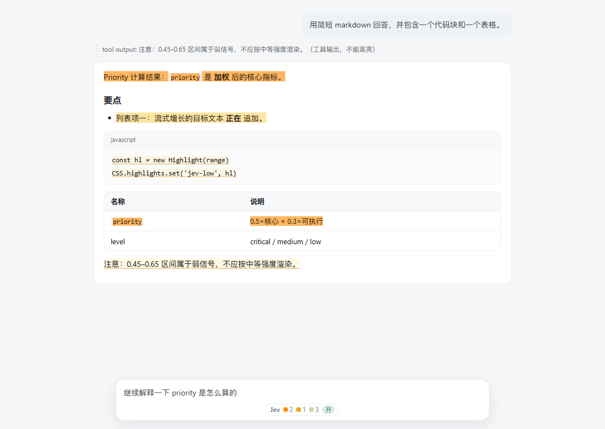

# Jev Highlight：给 AI 的长回答画重点

> 一个运行在 **DeepSeek Harness** 里的 Web 插件：它不修改 AI 的输出，只在你阅读时，把回答里「最该看的部分」高亮出来。
>
> GitHub 仓库：https://github.com/Zorien-ai/dsh-jev-highlight

# 为什么想到做这个插件?

起因是因为我在逛github的weekly时看到了它[<我用Ctrl+F寻找答案>](https://blog.tymscar.com/posts/hunchsemanticfind/),看完后我突然想到我和他的经历有相同的地方:agent生成的长篇大论我一句都不想看.看完ai发的报告真的很需要精力,不仅有很多我没见过的内容,还不知道什么是重点(一般我只看最后的需要你确认的事).因此我就想用jev来标注重点信息,而且对应插件生态最好的是DeepSeek Harness.理论成立,ai也认为可行,即刻开始..

---

## 30 秒版本

- **给谁用**：每天读 AI 长报告、长回答，看到最后已经没力气的人。
- **解决什么**：不替你删内容、不替你总结，而是用「高亮」告诉你：哪句是结论、哪步可以执行、哪里有风险。
- **怎么判断**：把回答切成一段段「语义单元」，逐个问决策模型 4 个是/否问题，再加权算出一个优先级。
- **看到什么**：重点用强高亮、重要内容用中等高亮、弱相关用淡高亮；底部还有一个计数小徽章，可随时开关。
- **默认模型**：StartLux-Decision（国产，Bamboo Relay）；TypeSafe Jev 也保留可选。
- **要不要折腾**：需要自己准备一个 API Key，然后在「设置 → 插件（部分版本叫「内置插件」）→ Jev 高亮」里粘贴即可。

---

## 它到底解决什么问题？

AI 的回答通常有三个特点：

1. **很长**：一屏接一屏，读起来很累；
2. **有很多陌生概念**：读着读着就要停下来查；
3. **重点和废话混在一起**：真正的结论、下一步操作、风险提醒，可能藏在第三段最后一句。

结果就是：我们往往只扫一眼最后「需要你确认」的部分，前面的推理和关键信息都跳过了。

这个插件不是替你「读」，而是替你**标出阅读顺序**：

- 最该先看的内容 → 醒目的高亮；
- 重要但可以稍后看的内容 → 中等高亮；
- 有点关系但不必优先看的内容 → 很淡的高亮；
- 寒暄、过渡、无关内容 → 不标。

它更像一支**会自己判断的荧光笔**，而不是一个摘要器：原文一个字都不会少，你仍然可以完整阅读，只是眼睛知道先落在哪里。

---

## 装上之后，我会看到什么？

### 1. 回答里的三档高亮

| 档位 | 含义 | 视觉表现 |
|---|---|---|
| **critical（重点）** | 直接回答你的问题，且包含关键风险 / 可执行步骤 / 核心结论 | 最明显的背景高亮 |
| **medium（中等）** | 直接答案、具体步骤或关键定义，但优先级稍低 | 半透明背景 |
| **low（弱）** | 相关的提醒、次要动作或泛泛建议 | 更淡的背景 + 弱提示 |
| 无 | 与问题关系不大 | 不标 |

> 具体阈值可以在设置页改，见下文「觉得高亮太多/太少怎么办？」



### 2. 输入框下方的计数小徽章

页面底部（输入框附近）会出现一个 `Jev` 小徽章：

- 显示当前这一轮/会话里各档高亮的数量；
- 可以一键开启或关闭高亮；
- 没有配置 Key、路由异常时，会直接显示原因。

### 3. 设置页

在 **设置 → 插件（部分版本叫「内置插件」）→ Jev 高亮** 里可以：

- 保存 / 清除 StartLux API Key；
- 测试连接；
- 切换思考模式（never / auto / always）；
- 修改高亮阈值（或一键套用「敏感 / 保守」预设）。

> 设置页入口在不同 DSH 版本里可能叫「插件」或「内置插件」，以你看到的为准。

---

## 它是怎么判断「重点」的？

整个过程分 4 步，全部在后台自动完成：

```
Agent 正在流式输出
      │
      ▼
切成一个个「语义单元」
（段落 / 列表项 / 代码块 / 表格行）
      │
      ▼
每个单元问决策模型 4 个是/否问题
  · 这是不是直接回答用户的核心答案？
  · 这里有没有可执行的操作或步骤？
  · 这里有没有风险、限制或注意事项？
  · 这里有没有在定义/解释关键概念？
      │
      ▼
加权算优先级
priority = 0.5×核心答案
         + 0.3×可执行
         + 0.2×max(风险, 定义)
      │
      ▼
按阈值分档：重点 / 中等 / 弱 / 不标
      │
      ▼
浏览器用原生高亮 API 画出来
（只覆盖颜色，不改 AI 的输出）
```

几个设计上的考虑：

- **按语义单元判断，不按句子**：一段话是一个完整意思，拆碎了反而容易误判；
- **把用户问题带进判断**：每次判断会参考你当前的问题（`[question]`），所以「核心答案」不是凭语气猜的；
- **一次请求问 4 个问题**：快、省、还能组合出更细的语义；
- **加权公式在本地算**：模型只给 4 个概率，最终优先级和分档由插件决定，透明可解释。

---

## 为什么默认用 StartLux，而不是 Jev？

这个项目的起点确实是 Jev（TypeSafe 的决策模型），名字也保留了下来。但实际使用中遇到两个问题：

1. TypeSafe 在中国大陆网络下返回 **HTTP 451（地区不可用）**；
2. 即使能访问，也需要可用的 Jev Key。

所以现在默认换成了国产的 **StartLux-Decision**（Bamboo Relay 提供兼容接口）：

| 提供方 | 默认接口 | 默认模型 | Key 从哪里来 |
|---|---|---|---|
| `startlux`（默认） | `https://api.bamboonode.dev/v1/decisions` | `startlux-decision-27b-autothink` | 设置页输入，或 `STARTLUX_API_KEY` / `BAMBOO_API_KEY` |
| `jev`（可选） | `https://api.typesafe.ai/v1/systemone` | `jev-1.13.0` | `JEV_API_KEY` / `TYPESAFE_API_KEY`，或 `.credentials.yaml` 的 `jevApiKey` |

切换提供方需要改插件配置里的 `provider: jev`（设置页只负责 Key、思考模式、阈值，不负责切换提供方）。

---

## 怎么安装？

> 这是一个本地实验插件，目前**没有发布到 npm**，需要从源码目录安装。

### 你需要准备

1. 已经安装并能正常打开 **DeepSeek Harness**（Web 或桌面版）；
2. 一个可用的 **StartLux / Bamboo API Key**（也可用 Jev Key，但本机可能受 451 影响）；
3. 如果要自己构建：Node.js 20+。

### 方式一：安装为 DSH profile 插件（推荐日常使用）

```powershell
# 从 GitHub 克隆（或直接使用你本地已有的目录）
git clone https://github.com/Zorien-ai/dsh-jev-highlight.git
cd dsh-jev-highlight

# 安装到你的 DSH profile
dsh plugin --profile <你的 profile 名> add "<当前目录>"

# 然后按平时的方式启动 DSH：
#   · 桌面版：直接重启应用
#   · Web 版（标准 web profile）：dsh web
#   · 自定义 profile：按你平时启动它的方式即可
```

安装后刷新页面，输入框附近会出现 `Jev` 徽章。

### 方式二：开发时用 `--patch` 临时叠加（不安装）

```powershell
cd "<本目录>"
node scripts/build.mjs

# 先建一个一次性测试 profile（已有可跳过）
dsh --profile test-highlight --from-default-profile web --dump-config

# 用覆盖层启动；自定义 profile 直接启动即可，不要再追加 web 参数
dsh --profile test-highlight --patch ".\cordis.debug.yml" --port 10301 --no-open
```

打开日志里带 token 的 `http://127.0.0.1:10301/?token=...` 即可。

> 不想动真实 profile 的话，建议新建一个临时 profile 做试验，用完删掉。

---

## 怎么填 API Key？

1. 打开 **设置 → 插件（部分版本叫「内置插件」）→ Jev 高亮**；
2. 在 **API Key** 输入框粘贴 Key（StartLux/Bamboo 通常以 `sk-` 或 `bk-` 开头）；
3. 点 **保存**（会提示「API Key 已保存」）；
4. 点 **测试连接**，看到「连接正常：xxx ms」就说明通了。

保存后：

- Key 只写入 **宿主侧** 的 `$DSH_HOME/jev-highlight-startlux.key`（尽力设置为 0600 权限）；
- 不会回传到浏览器，也不会显示在页面/日志里；
- **立即生效，不需要重启**。

如果你更喜欢用环境变量：

- StartLux：`STARTLUX_API_KEY` 或 `BAMBOO_API_KEY`
- Jev：`JEV_API_KEY` 或 `TYPESAFE_API_KEY`

---

## 觉得高亮太多 / 太少，怎么办？

打开 **设置 → 插件（部分版本叫「内置插件」）→ Jev 高亮**，下方有「高亮阈值」区域，可以直接改三个数字：

- **critical**：达到多少分算「重点」；
- **medium**：达到多少分算「中等」；
- **low**：达到多少分算「弱」。

规则：`0 ≤ low ≤ medium ≤ critical ≤ 1`。

默认值：

| 提供方 | critical | medium | low |
|---|---|---|---|
| StartLux（默认，敏感预设） | **0.52** | **0.37** | **0.24** |
| Jev | 0.85 | 0.65 | 0.45 |

几个常见调整：

- **「重点」太多、太吵**：把 critical 调高，或点 **保守 preset**；
- **真正重要的没亮**：把 low/medium 调低，或点 **敏感 preset**；
- **只想看重点**：把 critical 调低、medium/low 调高（或不管，只看强高亮）；
- 点 **恢复默认** 会删除你的覆盖，回到上表默认值。

保存后，**已经出现的高亮也会按新阈值重算**：客户端在下一次轮询（约 2–3 秒）发现阈值变化，会清空并重建高亮，不需要刷新页面。

> 覆盖值保存在 `$DSH_HOME/jev-highlight-thresholds.json`，随时可以清掉。

---

## 它会不会改我的聊天记录或页面？

**不会。** 这是这个插件最重要的设计原则：

- 它只**读取**页面上已经渲染出来的文字，用来定位高亮位置；
- 高亮使用浏览器原生的 **CSS Custom Highlight API**（相当于给文字加一层「颜色覆盖层」）；
- 不插入节点、不包裹文字、不修改 AI 输出的 DOM；
- 复制出来的文字、聊天记录、数据库里的内容都保持原样。

关闭插件或关闭高亮，所有颜色立即消失。

---

## 为什么有时候没有高亮？

按出现概率从高到低：

1. **没有配置 Key**：设置页会显示「缺 API Key」，徽章也会提示；
2. **高亮被关掉了**：点一下底部 `Jev` 徽章重新开启；
3. **看的是旧会话**：插件只判断**实时流式输出**，不会回头补判历史消息；
4. **内容确实低于阈值**：普通寒暄、过渡句本来就不会高亮；
5. **文字定位失败**：同文重复、虚拟滚动、超长单元、代码块格式差异，可能导致某个单元找不到对应位置；
6. **网络/模型问题**：StartLux Key 无效返回 401/403；Jev 在中国网络可能返回 451；
7. **插件没装好/没启用**：确认 profile 里能看到 `jev-highlight` 这一项，并刷新页面。

高级排查（本机）：

- `GET /jev-highlight/state`：开关、Key、计数；
- `GET /jev-highlight/diag`：请求数、并发、缓存、最近错误；
- `GET /jev-highlight/provider`：当前提供方、模型、阈值来源；
- `GET /jev-highlight/prompts`：当前提示词设计。

---

## 它支持什么、不支持什么？

**支持：**

- 段落、无序/有序列表项、代码块、表格行；
- Markdown 回答（Web UI 渲染后的文本）；
- 中文/英文内容（判断质量见限制）；
- 流式输出：边生成边判断、边高亮。

**不支持：**

- 回看历史消息时补判；
- TUI / 纯终端界面（插件只带 Web 端）；
- 图片内容理解（只判断文本）；
- 替你改写、删减、总结回答；
- 替代事实核查：高亮只代表「这段话很重要」，不代表「这段话一定正确」。

---

## 我的 Key 安全吗？用起来要花钱吗？

- Key 只在**宿主进程**里使用，写入本机文件或环境变量；
- 插件的 HTTP 接口只返回 Key 是否配置，不返回值；
- 浏览器、页面日志、验收报告里都不包含 Key；
- 但请注意：**被判断的文本片段和你的当前问题会发送给所选的判别服务**（StartLux/Bamboo 或 TypeSafe）。不要在高度敏感的会话里使用不信任的第三方模型。

费用方面：

- **Bamboo Relay 当前处于测试期，官方文档写的是免费**（以官方页面为准）；
- Jev 按 TypeSafe 的规则计费；
- 插件本身不收费，也不会硬编码任何 Key。

---

## 它会不会很慢？会不会花很多 token？

默认配置下：

- 每个语义单元一次请求，4 个是/否问题合并成一次调用；
- 并发上限 8；
- 单请求预算 24k tokens，超长单元会自动切子块；
- 进程内 LRU 缓存，相同内容（同一问题、同一上下文）不会重复请求；
- 默认 `think_mode=never`，通常单请求约 1 秒；切到 `auto`/`always` 会变慢（见设置页说明）。

所以它适合「边看边标」，而不是等整篇回答生成完再离线分析。

---

## 名词小抄（看不懂术语时先看这里）

| 名词 | 用大白话解释 |
|---|---|
| **Agent** | 正在帮你干活的 AI；它会一行行「流式」输出回答。 |
| **语义单元** | 插件把回答切开后的「一小块意思」，通常是一段、一个列表项、一个代码块或一行表格。 |
| **决策模型** | 专门回答「是/否」或「选哪个」的模型，不负责写文章；这里用它给 4 个问题打分。 |
| **noul** | TypeSafe 的说法：一个「是/否」问题，返回的是「是」的概率（0–1），不是布尔值。 |
| **priority（优先级）** | 插件把 4 个概率按权重合成的一个 0–1 分数，用来决定高亮档位。 |
| **阈值（threshold）** | 分档的分数线；例如 critical ≥ 0.52 才算「重点」。 |
| **API Key** | 你向模型服务证明「这是我」的密钥；相当于账号密码，不要发给别人。 |
| **CSS Custom Highlight API** | 浏览器的原生高亮能力：只给文字加颜色覆盖，不改页面结构。 |

---

## 不想用了，怎么关掉或卸载？

- **临时关闭高亮**：点输入框下方的 `Jev` 徽章，或调用 `POST /jev-highlight/toggle`；
- **暂时停用插件**：在 DSH 的插件管理里把 `jev-highlight` 禁用（下次启动生效或按界面提示重启）；
- **彻底卸载**：在 profile 的插件管理里移除 `@local/dsh-jev-highlight` 这个 bundle（建议用 `dsh plugin` 命令或插件管理器操作，不要手改 profile 的 `package.json`）；
- **删除本地 Key/阈值**：删除 `$DSH_HOME/jev-highlight-startlux.key`、`jev-highlight-think-mode`、`jev-highlight-thresholds.json` 即可（删除后记得重启或重新加载插件）。

---

## 开发者：怎么跑起来、怎么测试？

```powershell
cd "<本目录>"

# 构建（生成 lib/index.js 和 lib/client.js）
node scripts/build.mjs

# 类型检查
node node_modules/typescript/bin/tsc -p tsconfig.json --noEmit

# 测试：当前 151 个测试，全部通过
node --test "test/**/*.test.mjs"
```

目录结构：

```
dsh-jev reader/
├─ src/
│  ├─ index.ts          Host 入口（name / inject / Config / apply）
│  ├─ contract.ts       两半共享类型、加权公式、阈值映射
│  ├─ host/             Host 半边：流捕获、切分、判别客户端、缓存、并发、路由
│  └─ client/           Client 半边：轮询、DOM 文本映射、CSS 高亮、徽章、设置页
├─ lib/                 构建产物（index.js / client.js）
├─ scripts/             构建、mock 服务、E2E、Jev 探针、阈值校准/A-B 实验
├─ test/                Host/Client 单元测试与 mock 全链路
├─ docs/                公共技术文档（原始验收产物不入库）
├─ cordis.patch.yml     安装为 profile bundle 时插入的配置
├─ cordis.debug.yml     开发用 --patch 覆盖层
├─ PLUGIN-README.md     详细技术说明（实现细节、配置、验收证据）
└─ README.md            你正在读的这份「给人看」的说明
```

想了解更多：

- [PLUGIN-README.md](PLUGIN-README.md) — 完整技术文档（配置项、协议、验收、限制）；
- [docs/jev-api.md](docs/jev-api.md) — TypeSafe Jev 与 StartLux/Bamboo 的接口契约；
- [docs/dom-notes.md](docs/dom-notes.md) — DOM 定位与只读高亮的约束；
- [docs/client-verification.md](docs/client-verification.md) — 前端高亮验证；
- [LICENSE](LICENSE) — MIT 许可证。

---

## 这些结论是怎么验证的？

- 自动化验收：mock 判别服务 + 真实浏览器驱动，**8/8 条验收标准、17/17 检查项通过**；
- 真实 StartLux 链路：P1–P11 手工评测全部跑通，25 条 unit 的 priority→level 重算 **0 误差、0 错配**；DOM 三态哈希一致、MutationObserver 0 变更；
- 真实运行样本：55 条 unit 的档位分布与 chip/CSS 计数一致；
- 阈值校准与 A/B：48 条标注语料 + 55 条真实 unit 盲标，敏感型被选为默认；
- 当前测试：`node --test "test/**/*.test.mjs"` → **151 / 151 通过**；`tsc --noEmit` 0 error。

完整证据与复现命令见 [PLUGIN-README.md](PLUGIN-README.md)；原始验收运行产物（截图/日志/本地路径）不随仓库发布。

---

## 已知限制（先说清楚，避免误会）

- **只判断实时流**：打开/恢复旧会话不会补判历史消息；
- **只支持 Web UI**：终端/headless 只有 Host 半边，没有高亮；
- **阈值是产品口径，不是真理**：不同模型、不同语言、不同写作风格都需要重新校准；
- **中文不是 Jev/StartLux 的最强项**：高亮强弱只能当提示，不要当结论；
- **文字定位是启发式**：同文重复、虚拟滚动、超长单元可能漏标或错标；
- **用户点「停止生成」时**：当前 DSH 会把流标记为 committed，插件仍可能判完已经流出的内容（不会中断在途请求）；
- **缓存只在进程内**：重启后需要重新判断；
- **Jev 在中国网络可能 451**：这正是默认换成 StartLux 的原因；
- **StartLux 目前是测试期服务**：可用性、价格、模型版本以 Bamboo 官方为准；
- **它不判断“对不对”**：只判断“重不重要”。

---

## 参考与致谢

- 灵感来源：[<我用Ctrl+F寻找答案>](https://blog.tymscar.com/posts/hunchsemanticfind/) —— 谢谢你，让我知道“读长文找重点”这件事可以被工具化；
- TypeSafe Jev —— 最初的决策模型与 `noul` 提问方式；
- [StartLux-Decision](https://github.com/StartLuxLabs/StartLux-Decision) 与 [Bamboo Relay 文档](https://bamboonode.dev/docs/ai-model/decisions/startlux) —— 国产默认后端；
- DeepSeek Harness（本插件的宿主）—— 提供了插件生态、流式事件与 Web UI；
- [MDN: CSS Custom Highlight API](https://developer.mozilla.org/docs/Web/API/CSS_Custom_Highlight_API) —— 不改 DOM 也能做高亮的关键；
- 以及所有在本地验收、校准和「读长文」这件事上提供反馈的人。

---

## 许可证

本项目使用 **MIT License**，见 [LICENSE](LICENSE)。

Copyright (c) 2026 Jev Highlight contributors。

你可以自由使用、修改、分发本项目（包括商业用途），只需保留版权声明和许可证文本。插件连接的模型服务（StartLux/Bamboo、TypeSafe Jev 等）有各自的条款与费用，不属于本许可证范围。
